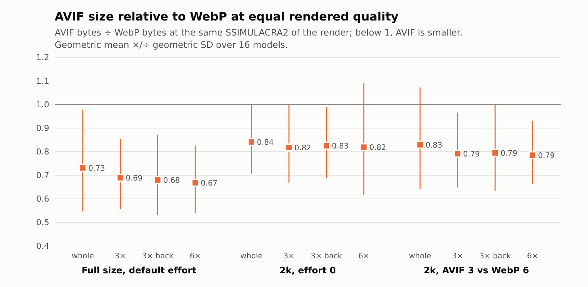
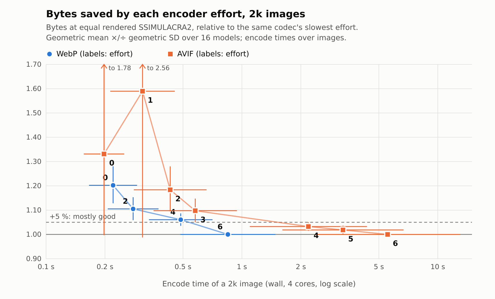
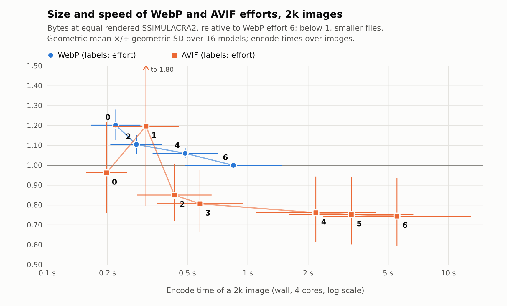

# Experiment: WebP against AVIF

Which of WebP and AVIF a texture command should write besides KTX2. The answer, AVIF, became the `avif` command ([avif.md](../avif.md)). First support and decoding in viewers, then, since they come out equivalent, file size and encoding speed.

## Support

The two formats are close to equivalent for eCorpus's viewer.

- **Browsers.** Full support covers 97.2 % of users for WebP and 96.7 % for AVIF (caniuse data, November 2026). AVIF also misses Safari before 16 (16.4 on macOS for full support; 16.0 to 16.3 have still images only), iOS before 16, and Edge before 121 (January 2024). Firefox has had it since 93, Chrome since 85.
- **three.js.** `GLTFLoader` reads `EXT_texture_webp` and `EXT_texture_avif` with the same code (AVIF since three.js PR #25173, early 2023). Voyager uses three.js 0.184 and the stock loader (`source/client/io/ModelReader.ts`). Both go through `ImageBitmapLoader` (`createImageBitmap`) where the browser has it. r184 doesn't test for support: a browser without AVIF fails to load the texture.
- **GPU memory.** Both decode to RGBA8, 32 bits per texel plus mips, where KTX2 stays block-compressed (4 or 8 bits). The choice between WebP and AVIF doesn't change it.
- **Size limits.** WebP can't exceed 16,383 texels a side. AVIF decoders limit images too (libavif's default: 16,384² texels). No local model has a texture over 8,192.
- **Decoding speed.** Measured below: the same, within the measurement's noise, at equal quality.

## Measurements

`tools/experiments/textures/webp-avif.sh` on the six sources of [fast-textures.md](fast-textures.md#setup) (scan color maps of 2k, 4k and 8k, scan-10m's 8k normal map, DamagedHelmet's 2k normal and ORM maps), through vips 8.16: libwebp 1.5 (lossy, `effort` 4 unless stated), and libheif 1.23 with aom 3.12 to encode AVIF (`effort` 4) and dav1d to decode. sharp, and so glTF-Transform's `textureCompress`, uses the same libraries. `webp-avif-summary.py` matches qualities. The rows are in [webp-avif.csv](webp-avif.csv).

- **Quality** is PSNR and SSIM against the source (ImageMagick `compare`), not a perceptual metric such as SSIMULACRA2, which isn't installed.
- **Sizes at equal quality:** for each WebP quality from 50 to 95, the size of an AVIF of the same PSNR, interpolated between AVIF qualities on a log scale.
- **Times** are CPU seconds (user + sys, all threads), and include decoding the PNG source (the "png" rows: 0.2 s at 2k, 1.1 s at 4k, 5 to 9 s at 8k). The load average was about 2 during the run, from something other than this run: compare within an image.
- **Decoding** is `vips avg` on the file, which decodes every texel and adds little: libwebp and dav1d, as Chrome and Firefox decode them. Safari decodes through the system's ImageIO, not measured.

### Size

AVIF size as a fraction of WebP's, at the same PSNR and at the same SSIM, over WebP qualities 50 to 95:

| Image | Same PSNR | Same SSIM | AVIF 4:4:4, same PSNR |
| --- | --- | --- | --- |
| color2k | 0.47 to 0.58 | 0.46 to 0.53 | |
| color4k | 0.66 to 0.74 | 0.70 to 0.73 | |
| color8k | 0.58 to 0.64 | 0.62 to 0.65 | |
| normal2k | 0.40 to 0.70 | 0.51 to 0.71 | 0.33 to 0.39 (WebP 80 to 95) |
| normal8k | 0.55 to 0.60 | 0.66 to 0.70 | 0.43 to 0.44 (WebP 90 and 95) |
| orm2k | 0.50 to 0.76 | 0.48 to 0.64 | 0.23 to 0.30 (WebP 90 and 95) |

- **AVIF is 24 to 60 % smaller at equal quality, on every image**, typically 40 %.
- **Data maps gain most from AVIF's full chroma (4:4:4).** Lossy WebP always halves chroma resolution, which caps its PSNR on normal and ORM maps; at WebP's top qualities, a 4:4:4 AVIF of the same PSNR is a quarter to 44 % of the size. (vips encodes AVIF 4:2:0 below quality 90 by default.)
- Lossless WebP of the 8k normal map is 58 MB, against 4 MB lossy: not a candidate.

### Encoding

CPU seconds for the source's PNG decode plus the encode, at WebP quality 80 and at an AVIF of the same PSNR, and both formats' fastest settings at about the same quality:

| Image | WebP 80 | AVIF, same PSNR | WebP 80, effort 0 | AVIF 60, effort 0 |
| --- | --- | --- | --- | --- |
| color4k | 1.9 s, 1.53 MB, 37.7 dB | 28.6 s, 1.11 MB | 0.8 s, 1.76 MB, 38.1 dB | 1.2 s, 1.22 MB, 37.1 dB |
| color8k | 26.1 s, 5.41 MB, 38.8 dB | 105 s, 3.32 MB | 5.7 s, 5.93 MB, 39.1 dB | 7.9 s, 3.54 MB, 38.3 dB |
| normal8k | 28.4 s, 3.95 MB, 39.0 dB | 118 s, 2.22 MB | 10.2 s, 4.49 MB, 39.5 dB | 11.4 s, 2.54 MB, 38.5 dB |

- **At default efforts, AVIF costs 4 to 15 times WebP's CPU** (aom runs on about 3.5 cores: 1.2 to 4.4 times the wall time on this 4-core machine).
- **At effort 0, AVIF takes 1.1 to 1.5 times WebP's effort 0, and is 31 to 43 % smaller**, at about 1 dB lower PSNR: roughly 15 to 30 % smaller at equal PSNR, extrapolating along the effort 4 sweeps (20 to 30 % more bytes per dB). Effort 2 costs 2 to 5 times effort 0's CPU for 0.05 to 0.4 dB.
- **AVIF effort 6 isn't worth it:** 2.4 to 3 times effort 4's CPU for 0.2 dB.
- **WebP effort 6** writes 2 to 6 % smaller files at 0.1 to 0.3 dB lower PSNR, no gain at equal quality, for 1.5 to 2 times the time. Effort 0 writes 10 to 15 % larger files at 0.3 to 0.5 dB higher PSNR, 2.4 to 4.6 times faster.
- **libwebp is slow on 8k images:** 20 s for color8k at effort 4 against 1.5 s at 4k, through vips and through Pillow (libwebp 1.6) alike, with the same bytes. VP8 caps the first partition (512 KiB), and libwebp likely re-encodes when an image overflows it; not checked further.
- **Encoder memory:** AVIF peaks at 1.4 GiB at 8k (2.3 GiB at quality 90 or in 4:4:4), WebP at 0.3 to 0.6 GiB (1 GiB with `smart_subsample`). ETC1S peaks at 3.5 GiB on the same image ([fast-textures.md](fast-textures.md#measurements-so-far-ktx2)).

### Decoding

At equal PSNR, decoding takes the same CPU within about 15 %: 0.40 s (WebP) against 0.44 s (AVIF) at 4k, 1.3 to 1.5 s for both at 8k. At the highest qualities AVIF decodes up to 30 % slower (1.9 s against 1.5 s at 8k), and both decode 3 to 7 times faster than the PNG source.

## Perceptual metrics: the gap is smaller

PSNR and SSIM, the metrics above, correlate worst with human opinion, and favour codecs that smooth: on CID22 (Cloudinary's 22,000 images rated by people, 2023), the rank correlation (Kendall) with mean opinion is 0.35 for PSNR and 0.42 to 0.56 for SSIM, against 0.69 for SSIMULACRA2 and 0.66 for Butteraugli. Published comparisons that use the perceptual metrics find AVIF's advantage over WebP smaller than the PSNR figures here:

| Source | Content | PSNR | SSIMULACRA2 | Butteraugli |
| --- | --- | --- | --- | --- |
| AVIF team, [avif-comparison subset1](https://storage.googleapis.com/avif-comparison/subset1.html) (2022), BD-rate 0.1 to 3 bpp | 48 photos | −21 to −31 % | −18 to −28 % | −16 to −18 % |
| [kadykov/web-image-formats-research](https://github.kadykov.com/web-image-formats-research/report/format-comparison.html) (2025), interpolated from its per-quality means | DIV2K, 86 photos | | −24 to −28 % | −16 to −21 % (−34 % at one high-quality point) |
| [Cloudinary](https://cloudinary.com/blog/jpeg-xl-how-it-started-how-its-going) (2023; the author co-created JPEG XL) | about 300 images | | −10 to −15 % | |
| [iminify](https://www.iminify.com/blog/5-avif-vs-webp-file-size-ten-images-one-quality-score-and-where-webp-still-wins) (2026, a vendor), at SSIMULACRA2 80 | 6 photos | | −31 % (−24 % with avifenc 1.2.1) | |

The 1.4 encoder in the last row uses libaom's `tune=iq`, which is tuned on SSIMULACRA2 itself.

Diffuse textures of scans are the unfavourable case:

- **CID22's human scores** (the [paper](https://cloudinary-marketing-res.cloudinary.com/image/upload/v1682076683/CID22.pdf), "Results by image category"): "in the non-photographic categories (diagram-chart and illustration-logo-text), AVIF outperforms other codecs, while for landscape-nature and materials-clothes, it does not perform well." Materials and natural surfaces are what scan textures show.
- **AV1 smooths fine texture.** [cbloom](http://cbloomrants.blogspot.com/2021/01/avif-test.html) (2021, against JPEG): "AVIF preserve[s] sharp edges well but kills speckle type high frequency texture", and "AVIF wins strongly in RGB RMSE but not in my other perceptual metrics". [bunny.net](https://bunny.net/blog/lets-talk-avif-and-why-we-are-not-adding-support-just-yet/) reports the same loss of detail on fur, skin and fabric.

So for diffuse textures, expect AVIF about 10 to 25 % smaller than WebP at equal perceived quality, possibly less on noisy surfaces, rather than this page's 40 %. The PSNR figures still stand for what they measure. Normal and ORM maps are judged by shading, not by eye, so PSNR is the more relevant metric there, and WebP's 4:2:0 limit is real (Cloudinary notes it too: "at q90+, it struggles to even reach the quality of JPEG"). Viewing differs from these studies as well: a texture is minified (mipmaps hide detail loss) or magnified on a close-up (which shows it).

## Rendered models

What counts is how a model looks in a viewer, not texture error. So the textures of 16 collection models were encoded with both codecs, the models rendered with each set, and each render scored with SSIMULACRA2 against the render with the model's own textures. The models are diverse:
- stone, marble and metal scans with color maps only (collection-01, collection-05, collection-08, collection-12, collection-16, collection-33, `collection-34`, collection-40);
- objects with normal maps (collection-17, comb, collection-23, cup);
- full PBR models (collection-27, collection-15, globe, collection-55 cup).

That's 37 textures of 2k to 8k.

### Method

`tools/experiments/textures/webp-avif-render.py`, with `render_variants.py` in Blender 5.2 and `ssimulacra2_rs` 0.5.2 (the Rust port of SSIMULACRA2, built with `cargo install --no-default-features`). The rows are in `webp-avif-render-*.csv` (main run) and `webp-avif-sweep-*.csv` (effort sweep).

- **Rendering:** EEVEE, 1024×768, the glTF importer's materials (base color, normal and metallic-roughness maps; Blender doesn't render occlusion maps, whose bytes still count), a sun and an even white world, "Standard" view transform.
- **Views:** the whole model; 3× close-ups from the front and the back; a 6× close-up, where a texel of a 4k to 8k texture covers about a pixel.
- **Scoring:** each render is cropped to the model's outline and put over mid gray, and scored against the reference render of the same view. EEVEE is deterministic: two renders of the same textures score 100.
- **Settings:**
  - **Full size:** every texture at its own size, both encoders at their default effort (4), four qualities each (WebP 50 to 95, AVIF 35 to 80).
  - **Fast:** textures scaled to 2k at most (Lanczos 3), against the model with the scaled textures stored losslessly. Efforts 0, and the slowest under 1 s on 4 cores (WebP 6, AVIF 3).
  - **Effort sweep, 2k:** WebP efforts 0, 2, 4 and 6, AVIF 0 to 6, four qualities each. Encodes were timed one at a time.
- **Comparison:** at each WebP point, the AVIF score at the same total texture bytes, and the AVIF bytes at the same score, interpolated against log bytes between AVIF qualities (`webp-avif-render-summary.py`, `webp-avif-sweep-summary.py`). Charts (`webp-avif-charts.py`) take one value per model (its median over views and qualities), then the geometric mean and standard deviation over models.
- **Efforts are each encoder's own scale:** the same number doesn't mean the same work, so settings are compared by time. aom runs on about 3 threads and libwebp on one, so wall time on 4 idle cores favours AVIF; CPU time is the cost when every core is busy, as on a server running parallel jobs.
- The load average was 1 to 3 during the runs, from other work on the machine: times are approximate.

### Same size, full-size textures

**At equal rendered quality, AVIF is about 25 % smaller** (bytes ratio median 0.72, middle half 0.54 to 0.81, over models, views and qualities):

| View | AVIF − WebP score at the same bytes | AVIF / WebP bytes at the same score |
| --- | --- | --- |
| whole model | +1.0 (middle half +0.5 to +2.5) | 0.75 |
| 3× close-up | +4.6 (+2.5 to +8.0) | 0.72 |
| 3× close-up, back | +5.4 (+1.9 to +8.6) | 0.73 |
| 6× close-up | +8.0 (+4.3 to +12.8) | 0.68 |

- **It holds at high quality:** for WebP points scoring 85 or more, the ratio is 0.76, and AVIF scores +1.1 at the same bytes.
- **Diffuse color only, a median of 0.78** over the 8 models without normal maps, from 0.47 (collection-16's smooth marble) to 0.94 (`collection-34`'s noisy stone) and 0.84 (collection-33). With normal maps, 0.74, down to 0.48 on the cup and the comb.
- **Close-ups gain the most.** On the whole model, mipmapping hides most of either codec's loss, and the gap is a point of SSIMULACRA2.

So rendering and a perceptual metric give AVIF less than PSNR on the textures does (0.6), and more than the published 10 to 15 % on photos. Diffuse textures sit at the top of the 10 to 25 % estimated above; the published caveat about noisy surfaces shows on `collection-34` only.

### Fast mode: 2k textures under 1 s

| 2k, at the same rendered score | AVIF / WebP bytes, all qualities | WebP scoring ≥ 85 | Encode time of a 2k image (median) |
| --- | --- | --- | --- |
| both at effort 0 | 0.82 | 0.92 | 0.20 s AVIF, 0.22 s WebP |
| AVIF 3 against WebP 6 (slowest under 1 s) | 0.85 | 0.95 | 0.62 s AVIF (1.8 s CPU), 0.86 s WebP |
| AVIF 0 against WebP 6 | 0.99 | 1.09 | 0.20 s AVIF, 0.86 s WebP |

- **Scaling to 2k costs more than either codec.** The lossless 2k textures score a median of 94 on the whole model, 80 on the 3× close-ups and 63 on the 6× close-up, against the models' own.
- **Under 1 s is a median, not a bound:** the slowest images took 1.4 s (AVIF 3) and 2.1 s (WebP 6).

### Effort: where results become mostly good

Geometric means over models; time is the wall time of a 2k image on 4 cores.

| Setting | Time (wall) | CPU | Bytes vs own slowest | Bytes vs WebP 6 |
| --- | --- | --- | --- | --- |
| WebP 0 | 0.22 s | 0.23 s | 1.20 | 1.20 |
| WebP 2 | 0.28 s | 0.29 s | 1.11 | 1.11 |
| **WebP 4** (libwebp's default) | 0.49 s | 0.52 s | **1.06** | 1.06 |
| WebP 6 | 0.85 s | 0.88 s | 1 | 1 |
| AVIF 0 | 0.20 s | 0.30 s | 1.33 (×/÷ 1.34) | 0.96 |
| AVIF 1 | 0.31 s | 0.66 s | 1.59 (×/÷ 1.61) | 1.20 |
| AVIF 2 | 0.43 s | 1.22 s | 1.18 | 0.85 |
| **AVIF 3** | 0.58 s | 1.82 s | **1.10** | **0.81** |
| **AVIF 4** (vips's default) | 2.19 s | 8.35 s | **1.03** | **0.76** |
| AVIF 5 | 3.28 s | 11.45 s | 1.02 | 0.75 |
| AVIF 6 | 5.55 s | 23.42 s | 1 | 0.75 |

(CPU: medians per image.)

- **WebP is mostly good at effort 4**, its default: 6 % over effort 6, in 0.5 s instead of 0.85 s. Effort 2 is 11 % over.
- **AVIF is mostly good at effort 4** (3 % over effort 6), but that is a step: effort 3 is 10 % over in a quarter of the time (0.58 s against 2.2 s; 1.8 s of CPU against 8.4 s). Efforts 5 and 6 save 1 to 3 % more for 1.5 to 2.5 times effort 4's time.
- **AVIF efforts 0 and 1 are unreliable.** At quality 50, effort 1 made 11 textures of 7 models 2 to 140 times larger than effort 2: near-uniform normal maps worst (the comb's 2k normal map is 1.4 KB at every other effort, 356 KB at effort 1; the globe's 6.8 KB against 474 KB), occlusion and color maps too. Effort 0 made collection-16's marble 1.9 times larger (520 KB against 270 KB) and an occlusion map 1.6 times. Effort 2 is the fastest without such outliers.
- **At their mostly-good efforts, AVIF is 25 to 30 % smaller than WebP:**

  | AVIF effort against WebP effort 4, same rendered score | All qualities | WebP scoring ≥ 70 | ≥ 85 | Wall time | CPU |
  | --- | --- | --- | --- | --- | --- |
  | AVIF 4 | 0.73 | 0.75 | 0.83 | 4.5 times | 16 times |
  | AVIF 3 | 0.76 | 0.79 | 0.88 | 1.2 times | 3.5 times |
  | AVIF 2 | 0.81 | 0.85 | 0.99 | 0.9 times | 2.3 times |

  **The "slightly less fast" pair depends on what the time costs:**
  - **Wall time, with spare cores:** AVIF effort 3 against WebP effort 4, about the same wall time on 4 cores. AVIF is 21 to 24 % smaller (12 % at the highest qualities), for 3.5 times the CPU.
  - **CPU time, with every core busy:** WebP effort 6 (0.88 s of CPU) against AVIF effort 2 (1.22 s, still 1.4 times more). AVIF is 15 % smaller. The AVIF efforts as cheap as WebP's (0 and 1) are the unreliable ones, so at equal CPU AVIF's lead is about 10 to 15 %.

## Conclusion

- **AVIF over WebP** wherever a web format is written. On rendered models at equal SSIMULACRA2, AVIF is about 25 % smaller at full size (22 % on diffuse-only models, 24 % for WebP scoring 85 or more), with the same decoding speed, the same viewer path and memory, for 0.5 % fewer browsers. PSNR on the textures overstated it (40 %); published photo benchmarks understate it for close-ups.
- **Efforts:** WebP 4 and AVIF 3 or 4 are mostly good. AVIF 3 matches WebP 4's wall time on 4 idle cores for about 22 % fewer bytes, but uses 3.5 times the CPU; at equal CPU, AVIF's lead is about 10 to 15 % (AVIF 2 against WebP 6). AVIF 4 saves another 5 % for 4 times AVIF 3's time. Avoid AVIF efforts 0 and 1: they misbehave on some textures.
- **A fast 2k preset** gains less from AVIF: 8 to 18 % with both encoders at effort 0 (about 0.2 s and 0.25 to 0.3 s of CPU each), and scaling to 2k costs more than the codec choice.
- **Data maps in 4:4:4.** Normal and ORM maps gain the most from AVIF's full chroma.
- **The cost is the build.** WebP is one small C library (libwebp, BSD). AVIF needs libavif and an AV1 encoder: aom (large, BSD), SVT-AV1 (BSD) or rav1e (Rust), vendored and linked statically under AGENTS.md's rules, and dav1d only to read AVIF inputs.

Not measured: Butteraugli, browser decode times (Safari's in particular), half and quarter sizes ([fast-textures.md](fast-textures.md#still-to-measure)), and JPEG.
